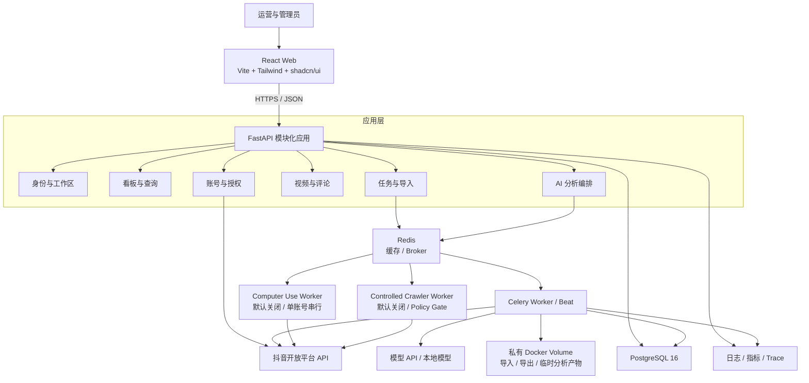
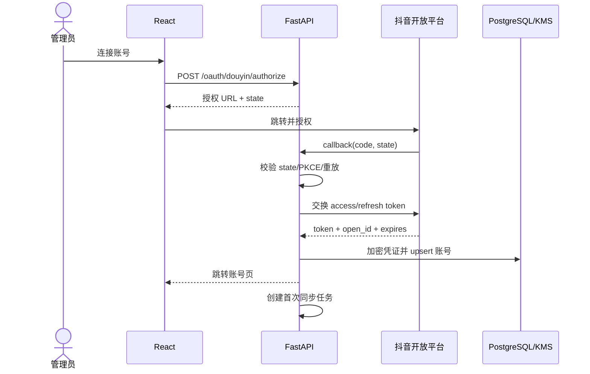
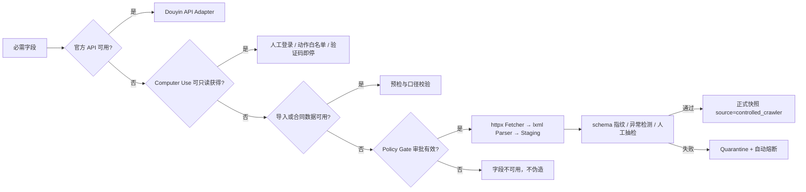
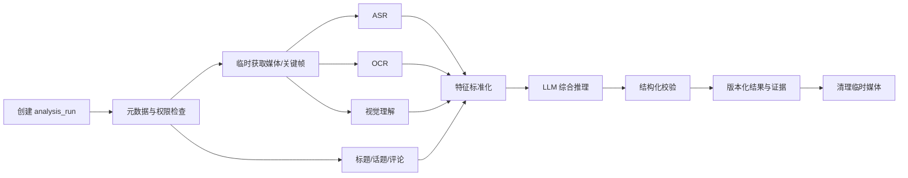

# VidInsight 系统架构

## 1. 架构原则

- 合规优先：官方 API 是主链路；Computer Use、授权导入/合作数据和受控爬虫按顺序补充缺失字段。
- 单体起步、边界清晰：MVP 使用模块化 FastAPI 应用，不提前拆微服务。
- 异步解耦：外部采集、导入、AI 和导出全部由 Celery 执行。
- PostgreSQL 优先：在数据量和查询证据出现前，不引入 ClickHouse 或 Elasticsearch。
- 原始数据可回溯、标准化数据幂等、指标口径可解释。
- 用户请求、异步任务、外部 API 调用与写库操作拥有统一关联 ID。

## 2. MVP 逻辑架构



### 2.1 运行单元

| 进程 | 职责 | 扩展方式 |
|---|---|---|
| `frontend` | 静态页面与 Nginx 反向代理 | CDN 或多个无状态副本 |
| `api` | 鉴权、查询、命令校验、任务创建 | 无状态水平扩容 |
| `worker-collect` | 官方 API 采集、刷新 Token、对账 | 按队列扩容；单账号加锁 |
| `worker-browser` | 受控 Computer Use、官方后台导出 | 默认关闭；单账号串行、独立会话 |
| `worker-crawler` | 审批字段的低频页面采集 | 默认关闭；域名级限流、独立熔断 |
| `worker-analysis` | ASR、OCR、LLM 和评论分析 | 按 CPU/GPU 与模型配额扩容 |
| `worker-io` | 文件导入、导出、清理任务 | 按 I/O 压力扩容 |
| `beat` | 周期性调度，只运行一个主实例 | 主从选举或单实例 |
| `postgres` | 主数据、快照、聚合和任务状态 | 托管高可用、只读副本 |
| `redis` | Celery Broker、短期缓存、分布式锁 | 托管高可用 |

## 3. 后端模块边界

```text
app/
├─ api/                 # HTTP 路由、依赖、错误映射
├─ core/                # 配置、安全、日志、遥测
├─ modules/
│  ├─ identity/         # 用户、工作区、成员、角色
│  ├─ accounts/         # 账号、OAuth、凭证、授权生命周期
│  ├─ collection/       # 数据源适配器、游标、快照、调度策略
│  ├─ videos/           # 视频、评论和查询
│  ├─ dashboard/        # 指标口径、趋势和排行
│  ├─ analysis/         # 分析流水线、模型适配器、结果版本
│  ├─ imports/          # 文件上传、预检、提交与错误报告
│  ├─ jobs/             # 任务状态、重试、取消和进度
│  └─ audit/            # 审计事件
├─ integrations/        # Douyin、Computer Use、受控爬虫、文件与模型服务客户端
├─ db/                  # Session、Base、迁移辅助
└─ tasks/               # Celery 入口，调用 modules 中的用例
```

路由层只做输入校验、鉴权和用例调用；业务逻辑不得写在 Celery task 或 ORM model 中。外部服务通过适配器访问，使测试可替换为 fake 实现。

## 4. 关键数据流

### 4.1 OAuth 授权



Token 明文只存在于调用所需的进程内存中，日志、错误和前端响应不得包含完整 Token。

### 4.2 增量采集

1. Beat 扫描应采集的账号和视频，根据年龄、优先级及近期 429 计算下次执行时间。
2. 创建带幂等键的 `collection_job`，并向对应队列发送任务。
3. Worker 获取账号级分布式锁，读取游标或高水位线。
4. 适配器调用官方 API；必要的原始响应以脱敏压缩文件写入私有持久卷并按期清理。
5. 在单个数据库事务中 upsert 主数据、追加指标快照并更新游标。
6. 发布域内事件，触发聚合刷新或分析任务。
7. 记录完成状态、调用次数、配额、延迟和下次采集时间。

幂等键建议为：

```text
{workspace_id}:{source}:{account_id}:{resource}:{window_or_cursor}
```

同一账号同类采集只允许一个任务运行。重试采用指数退避加抖动；429 优先读取 `Retry-After`，401/403 不盲目重试。

### 4.3 数据源兜底与受控爬虫



每个受控爬虫连接器必须有 `connector_id`、允许域名和路径、账号范围、字段白名单、业务目的、审批编号、频率/并发上限、响应大小上限、启用/到期时间、owner 与 Kill Switch。Policy Gate 在每次请求前校验；缺一项即拒绝执行。

Fetcher 使用固定企业出口、HTTPS 白名单、域名级令牌桶、条件请求和分页硬上限。DNS 解析前后及每次重定向后校验目标，禁止访问私网、环回、非 HTTP(S) 或未审批域名。遇到验证码、滑块、登录墙、挑战页、403、429 或访问政策变化立即熔断，不破解验证码、不逆向签名、不伪装指纹、不轮换代理规避限制。

Parser 使用版本化选择器、`schema_fingerprint` 和脱敏 fixture。字段单位变化、缺失率异常、数值越界或页面指纹变化时只写 quarantine；连续三个样本异常自动关闭连接器。每周人工抽查至少 5% 或 20 条（取较大者），来源切换不得静默覆盖历史口径。

### 4.4 AI 分析流水线



每个步骤必须保存 `status`、`model`、`model_version`、`prompt_version`、成本、耗时和错误。LLM 输出使用 Pydantic/JSON Schema 校验，不把未验证自由文本直接写入业务字段。

## 5. 调度与限流

默认策略：

| 对象 | 发布后时段 | 建议间隔 |
|---|---:|---:|
| 新视频发现 | 全时段 | 5-15 分钟 |
| 视频指标 | 0-24 小时 | 5-10 分钟 |
| 视频指标 | 1-7 天 | 15-30 分钟 |
| 视频指标 | 8-30 天 | 2-6 小时 |
| 视频指标 | 30 天以上 | 每日或每周 |
| 评论 | 新视频 | 5-15 分钟 |
| 账号日指标 | 每日数据就绪后 | 每日一次 |

自适应间隔：

```text
next_interval = clamp(base_interval × pressure × age_factor ÷ priority, min, max)
```

`pressure` 来自 429、超时和服务错误；`age_factor` 随内容年龄增加；`priority` 来自账号和视频策略。所有参数进入配置而非硬编码。

## 6. 一致性与错误处理

- 外部 API 与本地数据库无法组成分布式事务，使用幂等键、游标和对账任务保证最终一致。
- 主数据采用唯一键 upsert；指标快照只追加，以 `(video_id, collected_at, source)` 去重。
- 任务处理语义为 at-least-once，所有消费者必须幂等。
- 聚合结果可重算，不作为唯一事实来源。
- 每日对账检查游标连续性、主从计数、连续零值和异常负增量。
- 死信任务保留上下文但不保存敏感 Token；人工修复后可重放。

## 7. 缓存策略

- 仅缓存高频只读聚合，例如总览和筛选选项；默认 TTL 30-60 秒。
- 缓存键必须包含工作区、筛选条件、权限版本与数据版本。
- 写入或采集完成后按标签失效，不依赖长 TTL 掩盖数据更新。
- OAuth、成员权限、任务真实状态不使用可能造成越权或陈旧控制的长缓存。

## 8. 演进门槛

### 8.1 引入 ClickHouse 的证据

满足任一条件并完成压测后评估：

- 指标快照持续超过 2 亿行；
- 典型趋势与聚合查询在合理索引、分区和物化视图后仍 P95 > 3 秒；
- PostgreSQL 分析查询明显影响事务写入；
- 数据分析需要高并发大范围扫描。

迁移时 PostgreSQL 继续保存控制面和主数据，ClickHouse 承担快照、增量和宽表。

### 8.2 引入 Elasticsearch 的证据

仅当 PostgreSQL 全文检索无法满足评论搜索、多字段相关性或向量混合检索时引入。MVP 可用 PostgreSQL `tsvector` / `pg_trgm`，向量需求可先评估 `pgvector`。

### 8.3 拆分服务的证据

当团队所有权、独立扩容、故障隔离或发布节奏产生明确需要时，优先拆出采集和 AI 分析 Worker；不要按技术层机械拆微服务。

## 9. 架构约束

- 所有数据库查询必须显式包含 `workspace_id` 或通过经过验证的工作区上下文注入。
- API 不直接等待外部平台批量采集或 AI 分析完成。
- Computer Use 使用独立 Worker、独立网络策略和显式功能开关。
- 受控爬虫使用独立 Worker、Policy Gate、域名级限流、staging/quarantine 和来源级 Kill Switch；默认不随主服务启动。
- 原始文件与媒体临时路径不经前端直接暴露；下载经 FastAPI 权限校验后流式返回。
- 业务日志结构化输出，字段至少包括 `request_id`、`workspace_id`、`user_id`、`job_id` 和 `source`，敏感字段必须脱敏。
