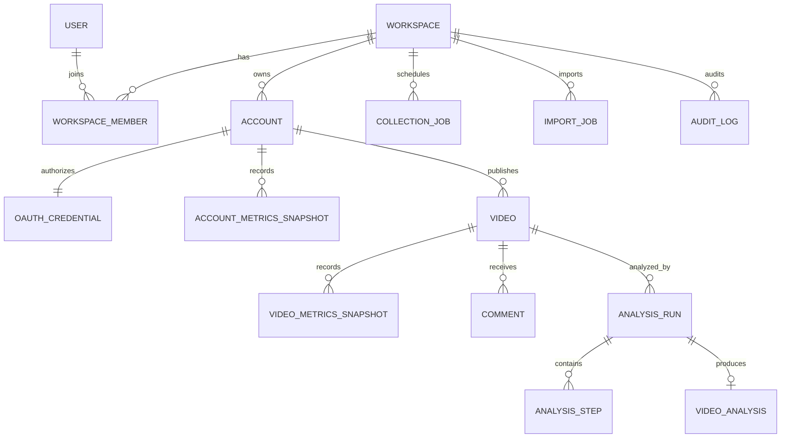

# VidInsight 数据模型设计

## 1. 总体原则

- PostgreSQL 16 是 MVP 唯一结构化事实库。
- 所有业务数据带 `workspace_id`，所有查询都验证工作区边界。
- 平台自然键与内部 ID 分离；对外暴露 UUID/ULID 风格标识。
- 视频与账号主数据可更新，指标快照只追加，分析结果按版本保留。
- 时间使用 `TIMESTAMPTZ` 并存 UTC；展示时转换为用户时区。
- 计数使用 `BIGINT`，比率使用 `NUMERIC` 或双精度并明确范围。
- `JSONB` 用于变化快、非核心检索字段，不替代稳定关系模型。
- Token、个人标识和评论内容按敏感等级独立治理。

## 2. 实体关系



## 3. 核心表

以下是逻辑模型。实际 DDL 由 SQLAlchemy model 与 Alembic migration 生成，命名保持一致。

### 3.1 身份与租户

#### `workspace`

| 字段 | 类型 | 约束 / 说明 |
|---|---|---|
| `id` | UUID | PK |
| `name` | VARCHAR(120) | 非空 |
| `slug` | VARCHAR(80) | 唯一、规范化 |
| `timezone` | VARCHAR(50) | 默认 `Asia/Shanghai` |
| `viral_rule` | JSONB | 可配置爆款规则与版本 |
| `status` | VARCHAR(20) | active/suspended |
| `created_at`, `updated_at` | TIMESTAMPTZ | 非空 |

#### `user`

`id`、`email`（使用大小写不敏感唯一索引）、`display_name`、`avatar_url`、`password_hash`（若使用本地登录）、`status`、`last_login_at`、时间戳。密码只存 Argon2id 哈希。

#### `workspace_member`

`workspace_id`、`user_id`、`role`、`created_at`，联合主键或唯一约束 `(workspace_id, user_id)`。角色只允许 `admin/operator/viewer`。

### 3.2 账号与授权

#### `account`

| 字段 | 类型 | 说明 |
|---|---|---|
| `id` | UUID | PK |
| `workspace_id` | UUID | FK，非空 |
| `platform` | VARCHAR(20) | MVP 固定 douyin |
| `platform_open_id` | VARCHAR(160) | 平台账号 ID |
| `nickname`, `alias` | VARCHAR | 平台名称与工作区别名 |
| `avatar_url` | TEXT | 可缓存或签名代理 |
| `authorization_status` | VARCHAR(20) | pending/active/expiring/expired/revoked/error |
| `priority` | SMALLINT | 1-10，默认 5 |
| `collection_enabled` | BOOLEAN | 默认 true |
| `follower_count` | BIGINT | 最新便捷值，不替代历史快照 |
| `video_count` | BIGINT | 最新便捷值 |
| `last_synced_at`, `next_sync_at` | TIMESTAMPTZ | 调度与新鲜度 |
| `created_at`, `updated_at` | TIMESTAMPTZ | 非空 |

唯一约束：`(workspace_id, platform, platform_open_id)`。索引：`(workspace_id, authorization_status)`、`(workspace_id, next_sync_at) WHERE collection_enabled`。

#### `oauth_credential`

| 字段 | 类型 | 说明 |
|---|---|---|
| `account_id` | UUID | PK/FK |
| `access_token_ciphertext` | BYTEA/TEXT | KMS/Vault envelope encryption |
| `refresh_token_ciphertext` | BYTEA/TEXT | 加密 |
| `scope` | TEXT[] | 实际获批 Scope |
| `expires_at`, `refresh_expires_at` | TIMESTAMPTZ | 到期时间 |
| `key_version` | VARCHAR | 加密密钥版本 |
| `rotated_at`, `updated_at` | TIMESTAMPTZ | 审计辅助 |

此表限制为授权服务账号可读。Token 禁止进入通用 ORM 序列化、日志和前端响应。

#### `account_metrics_snapshot`

存储 `follower_count`、主页访问量等账号级历史：`workspace_id`、`account_id`、各项 `BIGINT` 指标、`collected_at`、`source`、`request_id`。唯一约束 `(account_id, collected_at, source)`。`follower_count` 为本期必填验收字段；每个入网账号必须具备可计算期初/期末增量的可靠快照。

### 3.3 视频与指标

#### `video`

| 字段 | 类型 | 说明 |
|---|---|---|
| `id` | UUID | PK |
| `workspace_id`, `account_id` | UUID | FK，非空 |
| `platform_item_id` | VARCHAR(160) | 平台视频 ID |
| `title`, `description` | TEXT | 原始文本 |
| `cover_url`, `source_url` | TEXT | 不长期保存媒体文件 |
| `duration_ms` | INTEGER | 毫秒，避免单位歧义 |
| `width`, `height` | INTEGER | 像素 |
| `topic_tags` | JSONB | 原始话题列表 |
| `music_title` | VARCHAR(200) | 可空 |
| `is_pinned` | BOOLEAN | 置顶状态 |
| `published_at` | TIMESTAMPTZ | 平台发布时间 |
| `first_seen_at`, `last_seen_at` | TIMESTAMPTZ | 采集追踪 |
| `created_at`, `updated_at` | TIMESTAMPTZ | 非空 |

唯一约束 `(workspace_id, platform_item_id)`；索引 `(workspace_id, published_at DESC)`、`(account_id, published_at DESC)`。标题搜索可后续增加 GIN `tsvector` / trigram 索引。

#### `video_metrics_snapshot`

| 字段 | 类型 | 说明 |
|---|---|---|
| `id` | BIGINT | 内部 PK，适合高写入 |
| `workspace_id`, `video_id` | UUID | 非空 |
| `play_count`, `like_count` | BIGINT | 非负累计值 |
| `comment_count`, `share_count` | BIGINT | 非负累计值 |
| `favorite_count` | BIGINT nullable | 缺失必须为 null，不写 0 |
| `forward_count`, `download_count` | BIGINT nullable | 以实际字段为准 |
| `completion_rate` | NUMERIC(8,6) | 本期必填验收字段，范围 0–1 |
| `completion_sample_count` | BIGINT | 完播率样本数；存在时用于加权平均 |
| `avg_watch_ms` | BIGINT nullable | 非本期验收指标，有合法来源时写入 |
| `source` | VARCHAR(30) | `douyin_api/computer_use/authorized_import/contract_api/controlled_crawler/model_estimate` |
| `source_ref` | VARCHAR(200) | 导入批次、API 请求或模型版本 |
| `collected_at` | TIMESTAMPTZ | 指标时点 |
| `ingested_at` | TIMESTAMPTZ | 系统入库时间 |
| `quality_flags` | JSONB | 回退、异常、缺失等标记 |

唯一约束 `(video_id, collected_at, source)`；主索引 `(video_id, collected_at DESC)`，并按规模评估 `collected_at` 月分区。任何计数应有 `CHECK(value >= 0)`。

### 3.4 评论

#### `comment`

字段包括 `id`、`workspace_id`、`video_id`、`platform_comment_id`、`parent_platform_comment_id`、`author_hmac`、`content_ciphertext/content_redacted`、`digg_count`、`reply_count`、`published_at`、`collected_at`、`source` 和时间戳。

- 唯一约束 `(workspace_id, platform_comment_id)`。
- 原始平台用户 ID 不进入分析表，使用工作区密钥 HMAC 后的稳定标识。
- 若业务无需原文，优先只保存脱敏文本；需要原文时加密并限制访问。
- 删除策略不依赖视频级联误删审计证据，生产 DDL 对高价值数据优先 soft delete 或受控清理任务。

#### `comment_analysis`

`comment_id`、`sentiment`、`sentiment_score`、`intent`、`entities`、`risk_flags`、`model_version`、`analyzed_at`。分析与原评论分离，便于重算和按模型版本比较。

### 3.5 分析

#### `analysis_run`

| 字段 | 类型 | 说明 |
|---|---|---|
| `id` | UUID | PK |
| `workspace_id`, `video_id` | UUID | 非空 |
| `status` | VARCHAR(20) | queued/processing/partial/completed/failed/cancelled |
| `pipeline_version` | VARCHAR(50) | 分析管道版本 |
| `requested_by` | UUID | 用户或 system actor |
| `idempotency_key` | VARCHAR(160) | 防重复提交 |
| `progress` | SMALLINT | 0-100，仅展示辅助 |
| `estimated_cost`, `actual_cost` | NUMERIC | 统一基础货币 |
| `started_at`, `completed_at` | TIMESTAMPTZ | 可空 |
| `error_code`, `error_summary` | VARCHAR/TEXT | 安全错误信息 |
| `created_at` | TIMESTAMPTZ | 非空 |

#### `analysis_step`

每个 pipeline step 的状态、尝试次数、模型提供商、模型版本、prompt 版本、输入输出私有文件引用、token/计算用量、耗时和错误。唯一约束 `(analysis_run_id, step_name, attempt)`。

#### `video_analysis`

保存结构化最终结果：主题、标签、情绪、钩子、场景、ASR、OCR、爆款评分、置信区间、建议、证据引用、模型元数据和 `raw_analysis JSONB`。唯一约束 `(analysis_run_id)`；索引 `(workspace_id, viral_score DESC)` 与 `(video_id, analyzed_at DESC)`。

## 4. 任务、导入与审计

### 4.1 `collection_job`

字段：`id`、`workspace_id`、`account_id`、`resource_type`、`source`、`status`、`priority`、`cursor_before/after`、`idempotency_key`、`attempt`、`scheduled_at`、`started_at`、`finished_at`、`next_retry_at`、`request_count`、`records_read/written`、`error_code/summary` 和时间戳。

部分唯一索引保证相同账号和资源只有一个 `queued/running/retrying` 任务。Celery task ID 只作运行时关联，不作为领域主键。

### 4.2 `collection_checkpoint`

以 `(account_id, resource_type)` 为唯一键，保存分页游标、高水位时间、最后成功任务和更新时间。只有事务性数据写入成功后才能推进 checkpoint。

### 4.3 `import_job`

保存文件对象引用、文件哈希、模板版本、字段映射、状态、总行数、有效/错误行数、提交者和过期时间。上传同一文件不自动重复提交；预检结果可复用。

### 4.4 `audit_log`

| 字段 | 说明 |
|---|---|
| `id`, `workspace_id` | 标识与隔离 |
| `actor_type`, `actor_id` | user/system/service |
| `action` | 如 `account.disconnect` |
| `resource_type`, `resource_id` | 操作对象 |
| `result` | success/denied/failure |
| `reason` | 用户输入或策略原因，经过清理 |
| `ip_hash`, `user_agent` | 最小化记录 |
| `request_id`, `metadata` | 关联与安全上下文 |
| `created_at` | 不可修改时间 |

审计日志追加写入，普通业务用户不可更新或删除。

### 4.5 `collection_connector`

| 字段 | 说明 |
|---|---|
| `id`, `workspace_id` | UUID 标识与工作区隔离 |
| `name`, `source_type` | `douyin_api/computer_use/authorized_import/contract_api/controlled_crawler` |
| `status` | draft/pending_review/approved/enabled/disabled/expired/tripped |
| `account_scope` | 获批账号 UUID 数组或范围引用 |
| `allowed_domains`, `allowed_path_patterns` | 精确访问白名单；不得使用全域通配 |
| `allowed_fields` | 字段名、单位、口径和目标质量等级 |
| `purpose`, `approval_reference` | 业务目的与审批编号 |
| `rate_limit`, `max_concurrency`, `max_pages`, `max_response_bytes` | 资源与访问硬上限 |
| `enabled_from`, `expires_at`, `owner_user_id` | 生效、到期与责任人 |
| `parser_version`, `schema_fingerprint` | 解析器与页面结构版本 |
| `tripped_at`, `trip_reason` | 自动熔断状态 |
| `created_at`, `updated_at` | 时间戳 |

扩大域名、账号、字段或频率范围时创建新配置版本，不原地放宽已审批记录。

### 4.6 `collection_sample` 与 `collection_quarantine`

`collection_sample` 保存脱敏抽检结果、页面可见值、解析值、差异、复核人和时间；`collection_quarantine` 保存未进入正式事实层的解析结果、响应哈希、异常规则、schema 指纹和最小排障摘要。两表禁止保存完整 Cookie、Token、未脱敏个人信息或无保留必要的完整页面。

### 4.7 `metric_requirement`

为防止必需字段只停留在文档中，`metric_requirement` 为每个工作区保存 `metric_code`、`scope`（video/account/period）、`required=true`、允许来源、当前绑定连接器、`coverage_status`、最近有效时间、校验人和校验时间。MVP 固定登记：`play_count`、`like_count`、`comment_count`、`forward_count`、`follower_delta`、`completion_rate` 以及五类诊断所需的 `video_follow_conversion`。任一 `required=true` 指标没有有效来源或覆盖率未达 100% 时，工作区状态为 `not_ready_for_acceptance`。

## 5. 文件与原始数据布局

```text
{environment}/{workspace_id}/
├─ raw-api/{source}/{yyyy}/{mm}/{dd}/{request_id}.json.gz
├─ imports/{import_id}/source
├─ imports/{import_id}/errors.csv
├─ analysis/{analysis_run_id}/audio.enc
├─ analysis/{analysis_run_id}/frames/*.jpg
└─ exports/{export_id}/result.csv
```

最终技术选型的 MVP 使用 Docker 私有持久卷保存导入、导出和临时分析文件，目录不由 Nginx 直接公开；下载经 FastAPI 鉴权后流式返回。达到多节点部署或容量门槛后，才通过 ADR 引入 S3 兼容对象存储并改用短时签名 URL。媒体派生产物完成分析后按策略自动清理。

## 6. 指标查询与聚合

### 6.1 最新快照

MVP 可使用 `DISTINCT ON (video_id) ... ORDER BY collected_at DESC`、窗口函数或维护受控的 latest 表/物化视图。必须确保“最新”限定来源优先级，不能把模型估算覆盖官方值。

推荐来源优先级按指标分别配置：

```text
douyin_api / first_party > computer_use > authorized_import / contract_api > controlled_crawler > model_estimate
```

### 6.2 增量

增量是相邻可靠快照之差。若差值为负、间隔异常或来源切换，则设置质量标记并从默认增长聚合中排除。不可静默 `max(delta, 0)`，否则会掩盖平台回退与数据问题。

### 6.3 时区

日聚合按工作区时区定义自然日，但事实时间仍存 UTC。查询返回范围和时区，避免前后端各自猜测边界。

## 7. 数据分层与保留

| 层 | 内容 | MVP 存储 | 默认保留 |
|---|---|---|---:|
| Raw | 原始 API 响应、导入文件 | 私有 Docker Volume（多节点后可迁对象存储） | 30 天 |
| Normalized | 账号、视频、评论 | PostgreSQL | 按业务与隐私策略 |
| Snapshot | 指标时点事实 | PostgreSQL | 1 年 |
| Feature | ASR/OCR/向量/特征 | PG + 私有文件卷 | 按分析授权与成本 |
| Mart | 账号日报、视频生命周期等可重算聚合 | PG 物化视图 | 可重算 |
| Analysis | 版本化分析结果 | PostgreSQL | 默认长期，支持删除请求 |

评论原文默认 90 天，最长 180 天需合同依据；账号授权撤回后停止采集，并按合同与用户请求执行删除。审计与法定留存的冲突需由法务确定。

## 8. 迁移和数据质量

- Alembic 迁移文件必须可前向执行；高风险回滚使用修复迁移，不依赖自动 downgrade。
- 大表变更采用 expand → backfill → switch → contract，避免长时间锁表。
- 数据质量规则至少包括唯一性、非负计数、时间合理性、外键完整性、来源合法性、游标单调性和新鲜度。
- 每次模型或口径变化保留版本，历史报表不得在没有说明时静默改变。
- 生产数据修复必须有脚本、预览、影响行数、审计记录和复核人。
