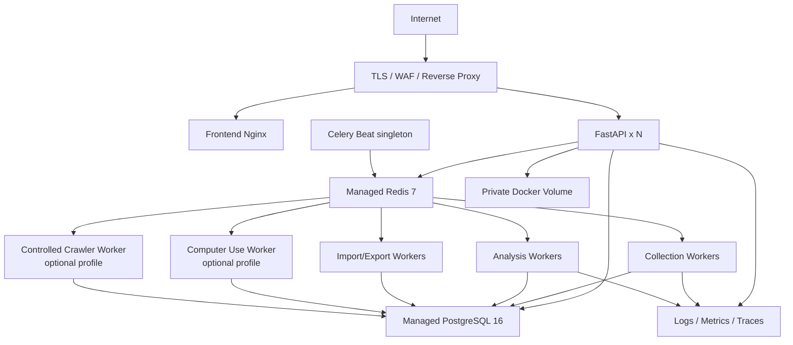

# VidInsight 部署与运维手册

## 1. 环境

| 环境 | 用途 | 数据要求 |
|---|---|---|
| local | 单人开发 | 生成数据或脱敏 fixture |
| test/CI | 自动测试 | 临时数据库，运行后销毁 |
| staging | 集成、验收、迁移预演 | 专用测试账号和脱敏数据 |
| production | 正式业务 | 严格权限、审计、备份和告警 |

环境完全隔离数据库、Redis、私有文件卷、OAuth 回调、浏览器 profile、爬虫策略和密钥。禁止用生产凭证连接本地或 staging。

## 2. MVP 部署拓扑

本地与小规模内部生产使用 Docker Compose、PostgreSQL、Redis 与私有持久卷，保持与最终技术选型一致。多节点、高可用或容量证据出现后，再评估托管服务、对象存储或 Kubernetes，不作为 MVP 前置条件。Computer Use 与受控爬虫放入独立 Compose profile，默认不启动。

## 3. 容器要求

- 镜像固定基础镜像 digest 或明确小版本，使用多阶段构建。
- 以非 root 用户运行；根文件系统尽可能只读。
- 运行镜像不包含编译器、测试依赖、`.git`、`.env` 和源码秘密。
- API/Worker 收到终止信号后停止接新任务并在宽限期内退出。
- 前端静态资源内容哈希并长期缓存，`index.html` 禁止长期缓存。
- 每个构建记录 Git SHA、构建时间和版本，通过 `/version` 暴露非敏感信息。

## 4. 配置与秘密

- 普通配置来自环境变量或配置服务；秘密来自 Vault/KMS/云 Secret Manager。
- 数据库密码、OAuth Secret、Token 加密主密钥和 AI Key 独立轮换。
- 前端构建变量视为公开信息，任何 Secret 不得使用 `VITE_*` 注入。
- OAuth 回调 URL、CORS Origin 和允许下载域名使用环境白名单。
- 应用启动校验配置组合，例如生产禁止 debug、通配 CORS 和弱默认密钥。

## 5. 发布流程

1. CI 完成静态检查、测试、迁移验证、镜像与 SBOM。
2. 同一不可变镜像部署 staging，执行 smoke 与迁移预演。
3. 生产发布前备份、确认告警静默范围、检查外部 API 状态和队列积压。
4. 先执行向后兼容的 expand migration。
5. 灰度 API 与 Worker，观察错误率、延迟、任务成功率和数据库负载。
6. 全量发布前端，完成 smoke test。
7. 观察至少 30 分钟；记录版本、操作者、迁移和验证结果。
8. contract migration 在旧版本完全退出且数据回填验证后另行发布。

回滚优先回滚应用镜像。数据库变更必须保持前后版本兼容；不可逆数据修复使用备份或补偿迁移，禁止临时手工改生产表。

## 6. 健康与可观测性

### 6.1 健康检查

- `/health/live`：进程事件循环可响应；不检查外部依赖。
- `/health/ready`：必要数据库与 Broker 可用、迁移版本兼容。
- Worker：心跳、最近任务时间与队列消费速率。
- Beat：最近调度时间，防止多个实例重复调度。

### 6.2 核心指标

| 范围 | 指标 |
|---|---|
| API | 请求量、状态码、P50/P95/P99、慢查询、连接池 |
| 采集 | 成功率、401/403、429、延迟、记录数、账号新鲜度 |
| 任务 | 各队列长度、等待时间、执行时间、重试、失败、死信 |
| AI | 各步骤成功率、耗时、token/调用成本、结构校验失败 |
| 数据 | 最新采集时间、异常负增量、重复率、游标停滞、空值率 |
| 基础设施 | CPU、内存、磁盘、PG WAL/连接/锁、Redis 内存与 eviction |

### 6.3 SLO 与告警

| 告警 | 建议条件 | 处理 |
|---|---|---|
| API 可用性 | 5 分钟错误率 > 5% | 检查最近发布和依赖，必要时回滚 |
| API 延迟 | P95 连续 10 分钟 > 3 秒 | 慢查询、连接池、缓存与资源诊断 |
| 采集成功率 | 15 分钟 < 95% | 按来源与错误码分流 |
| 授权异常 | 单账号连续 3 次 401/403 | 暂停账号并请求重新授权 |
| 平台限流 | 连续 5 次 429 或明显突增 | 自动降频，核查配额 |
| 数据过期 | 超过目标周期 2 倍 | 检查调度、队列与账号状态 |
| 任务积压 | 队列 > 1000 或等待超阈值 | 降低入队或扩 Worker |
| 磁盘/存储 | 使用率 > 80% | 清理过期数据并扩容 |

告警按用户影响分级并去重，避免每个失败任务单独呼叫。告警中不包含 Token、评论原文或个人信息。

## 7. 备份与恢复

- PostgreSQL：每日全量 + 持续 WAL/PITR，生产目标 RPO ≤ 15 分钟。
- 私有文件卷：随数据库备份策略保存必要元数据；导入/导出按期限清理，关键文件另做加密备份。
- Redis 不作为唯一事实来源；丢失后任务可从数据库状态恢复。
- 配置、迁移、监控规则保存在 Git；秘密系统单独执行恢复方案。
- 每季度至少一次从备份恢复到隔离环境，验证行数、约束、关键查询和应用启动。
- 目标 RTO ≤ 2 小时；演练记录实际 RPO/RTO 与改进行动。

## 8. 应急 Runbook

### 8.1 外部 API 大量 429

1. 确认影响来源、账号和时间范围。
2. 启用来源级熔断或提高 `pressure`，暂停非关键冷数据任务。
3. 遵循 `Retry-After`，禁止人工增加并发“追数据”。
4. 检查配额使用、版本变化和平台公告。
5. 恢复后低速放量并执行缺口对账。

### 8.2 Token/授权异常

1. 停止受影响账号的新采集，不影响其他账号。
2. 尝试一次受控刷新；明确无效后标记 expired/error。
3. 通知管理员重新授权，不要求通过聊天或工单发送 Token。
4. 授权恢复后从 checkpoint 继续并对账。

### 8.3 数据泄漏或平台投诉

立即启用全局 Kill Switch 或来源/账号级熔断，保全审计证据，撤销相关凭证，通知安全与法务，评估数据范围和法定义务。在批准前不得自行恢复。

### 8.4 错误数据写入

停止相关 producer，标记受影响时间窗，使用可审计脚本预览并修复；聚合全部重算。禁止直接覆盖原始事实来掩盖问题。

### 8.5 Computer Use / 受控爬虫异常

1. 发现验证码、挑战页、账号安全提示、403/429 激增、页面指纹变化或异常解析值时，立即触发连接器级 Kill Switch。
2. 撤销队列中的待执行任务，隔离浏览器 profile 或 crawler worker；不换 IP、不提高并发、不尝试绕过。
3. 将当前结果留在 staging/quarantine，不刷新正式聚合。
4. 核对审批、访问政策、允许字段、fixture 与抽样页面；必要时通知安全、法务和账号负责人。
5. 修复后先执行单页 dry-run 和人工对账；批准后以最低速率灰度恢复。

## 9. 容量与成本控制

- Celery 队列按 `collect`、`analysis`、`io` 隔离，防止 AI 长任务阻塞采集。
- 每个工作区配置 API 配额、并发、AI 日/月预算和导出上限。
- 私有文件卷设置 30 天原始数据、24 小时导出和更短的临时媒体清理任务。
- Computer Use/受控爬虫按连接器统计任务数、人工处理时长、抽样差异和页面变更维护成本；成本异常时自动停用非关键连接器。
- 先用索引、分区、物化视图和查询优化解决 PG 压力，再依据架构门槛引入 ClickHouse。
- 成本看板按工作区、模型、分析步骤和日期汇总，异常增长触发告警。
