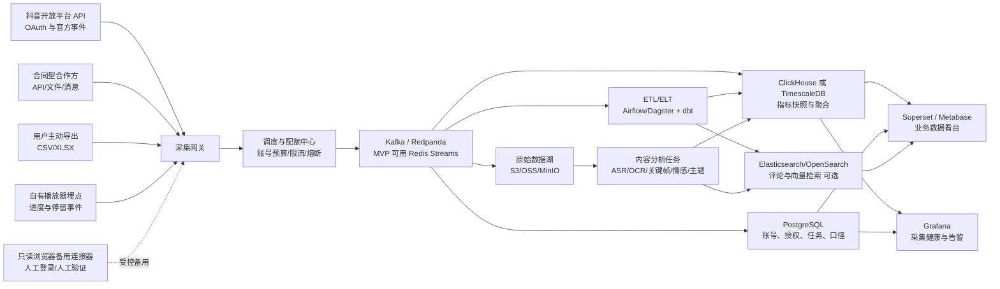
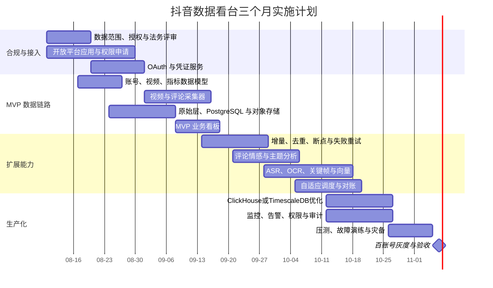

# 抖音多账号数据看台与内容分析建设研究报告

## 执行摘要

在“中等预算、监控 10–100 个自有或已获运营授权的抖音账号、保留一年、部分指标分钟级更新”这一**未指定假设**下，首选方案应是“抖音开放平台 OAuth 授权接口 + 合同型数据合作/用户主动导出 + 自有渠道播放埋点”的合规混合模式，而不是爬虫。抖音官方接口已能提供授权账号的视频列表、播放量、点赞、评论、分享等数据及评论内容，但标准接口公开文档中未见视频收藏数、逐用户播放进度或精确停留时长，因此这些指标不能简单依靠公开视频计数推导。citeturn15search14turn16search0turn16search1turn16search2

浏览器自动化只能作为自有账号、只读操作、人工登录、低频导出的临时补充；验证码或滑块出现时必须暂停并转人工，不应部署验证码破解、指纹伪装、代理轮换或签名逆向。HTTP 爬虫的稳定性、账号安全、平台协议和法律风险均较高，尤其现行《反不正当竞争法》已明确规制以欺诈、胁迫、避开或破坏技术管理措施等不正当方式获取、使用其他经营者数据的行为，因此本报告确认并采纳您的偏好：**爬虫方案不够安全，不建议作为生产主链路。** citeturn18search0turn18search5

技术上建议 MVP 使用 PostgreSQL、对象存储、Redis Streams、Airflow/Dagster 与 Superset；扩展至 50–100 个账号后，再引入 Kafka/Redpanda、ClickHouse，以及按需引入 Elasticsearch/OpenSearch。内容分析采用 ASR、OCR、标题与评论文本、关键帧和多模态向量融合；精确停留率只能基于合法获得的播放进度事件或官方聚合报表计算，缺失事件时只能输出明确标注的估算值。citeturn13search0turn13search4turn14search0turn20search0turn20search4

建议以约三个月完成从 10 个账号 MVP 到 100 个账号生产化，核心团队约 3–4 人；云资源规划费用约为 MVP 每月人民币 1,500–5,000 元、生产阶段每月人民币 8,000–30,000 元，不含数据合作采购、短信及大模型 API 等外部费用。以上为容量规划估算，不是云厂商报价。

## 数据边界与采集方案

**范围假设。** 以下设计假定账号属于贵方或贵方客户，已取得账号主体和相关用户的有效授权。预算、日均视频数、评论量、是否为企业号、是否已有巨量引擎或 MCN 合作关系均属**未指定**；这些因素会显著影响可申请的接口权限、数据颗粒度和最终费用。

**必须先接受的数据边界：**

抖音开放平台的 `video.list` 和 `video.data` 接口需要账号授权并申请对应权限，可以实时返回公开视频的播放、点赞、评论、分享、转发和下载等统计；`video.list` 当前公开文档注明暂不支持按时间过滤。评论列表则可通过 `item.comment` 权限分页获取。citeturn16search0turn16search1turn16search2

标准接口示例中的统计字段为 `digg_count`、`play_count`、`comment_count`、`share_count`、`forward_count` 和 `download_count`，**没有公开展示收藏数**。因此，“收藏”需在正式申请权限时向平台确认是否有面向特定账号类型、服务商或商业合作方的额外接口；不能将点赞或下载当作收藏。citeturn16search0turn16search2

公开视频计数不包含“某个观看者观看了几秒、在哪个进度退出、是否重复播放”等事件，因此无法据此准确计算停留率、完播率或逐用户偏好。官方数据开放接口中还有按日更新的用户粉丝、点赞、主页访问等指标，部分数据是次日更新，而非分钟级。citeturn15search7turn15search8turn19search7

### 采集方式总体比较

| 方案 | 实现方式与可获得数据 | 优点 | 主要不足 | 合规与法律风险 | 反自动化风险 | 稳定性 | 成本与账号影响 | 建议 |
|---|---|---|---|---|---|---|---|---|
| **抖音官方开放 API** | 创建开放平台应用；每个账号经 OAuth 授权；申请 `video.list`、`video.data`、`item.comment`、`data.external.user` 等 Scope；服务端安全保存和刷新令牌 | 官方数据、结构化、可审计；对账号影响最小；接口返回的公开视频统计可实时获取 | 权限需要审核；字段受 Scope 和账号类型限制；无标准收藏数、用户级播放进度；视频列表无时间过滤 | 低，但必须严格限制在用户授权和平台批准范围内 | 低，主要是配额、Token 失效、权限撤回 | 高 | 研发成本低至中；无账号池需求 | **首选主链路**。citeturn15search0turn15search4turn16search0turn16search2 |
| **第三方授权或合同合作** | 与官方系统服务商、MCN 数据服务方、商业开放平台或拥有合法数据授权的供应商签约；通过 API、文件推送、报表或消息订阅接入 | 可补充标准开放接口没有的报表、历史回溯、广告或企业经营数据；可约定 SLA | 供应商锁定；字段口径可能不同；费用较高；必须核验数据来源 | 中；风险取决于供应商是否有平台授权、用户授权、转授权权利和处理个人信息的合法基础 | 低至中 | 中至高 | 通常是主要外部成本；对账号影响低 | **推荐作为补充**，但合同必须明确来源、权限、删除、审计、违约和数据出境责任 |
| **浏览器自动化或智能体操作** | 对已授权自有账号使用独立浏览器上下文；人工扫码登录；只读访问创作者后台；下载平台提供的 CSV/XLSX 或读取可见汇总数据 | 能临时覆盖没有开放 API、但后台可见且允许导出的指标；易做 PoC | DOM 和页面流程易变；速度慢；登录态与验证码运维复杂；LLM 智能体行为不可完全预测 | 中至高；若超出账号授权、代理自动登录或规避平台措施，风险明显上升 | 高 | 低至中 | 浏览器节点和人工维护成本高；可能触发挑战、风控或账号限制 | 仅作**只读、低频、人工在环的过渡方案** |
| **HTTP 爬虫** | 请求公开网页或非公开 JSON 接口，解析账号、视频、评论和统计字段；维护请求签名、Cookie、解析器和数据清洗 | 初期看似灵活；无需等待官方 Scope 审核 | 接口频繁变化；字段口径不明；历史数据和登录态难维护；媒体与评论规模会迅速增加 | **高**；可能同时涉及平台协议、数据权益、个人信息、著作权和反不正当竞争风险 | **很高** | **低** | 持续逆向与维护成本高；可能连带影响账号、IP、设备及合作主体 | **不建议。符合您的判断：爬虫方案不够安全** |
| **被动数据采集与用户授权上报** | 账号运营者主动上传后台导出的 CSV/XLSX；桌面客户端读取用户主动选择的文件；自有网站、小程序或播放器在充分告知后上报播放进度事件 | 不需要规避平台措施；能获得自有渠道的真实播放事件；责任边界清晰 | 依赖用户操作；数据时效较差；只能覆盖用户可导出或贵方自有渠道 | 低至中；关键在告知、同意、最小必要和撤回删除机制 | 低 | 中至高 | 实施成本低；对账号影响很低 | **推荐补充方案** |
| **混合方案** | 官方 API 负责账号和视频统计；合同数据负责缺失报表；用户导出负责历史与特殊指标；自有播放埋点负责停留率；自动化只作为受控备用 | 覆盖面、稳定性、合规性和可降级能力最佳 | 架构、口径管理和数据血缘更复杂 | 中低，可通过数据源分级治理 | 低至中 | 高 | 中等预算可控；可按账号分层采购 | **整体首选** |

需要特别区分“拥有官方授权和可转授权合同的数据供应商”与“仅宣称能调用抖音接口的非官方 API 转售商”。后者即使返回结构化 JSON，也不自动意味着其采集方式、数据来源和后续使用获得平台或数据主体许可。采购前至少要求对方提供平台授权证明、数据来源清单、字段级授权范围、个人信息处理协议、删除机制、审计权和安全事件责任。

### 浏览器自动化与智能体的安全实现边界

| 技术问题 | 建议实现 | 明确不建议的做法 | 主要安全隐患 |
|---|---|---|---|
| **会话管理** | 每个账号使用独立持久化浏览器上下文和独立密钥；由账号持有人在官方页面扫码登录；Cookie 加密入库；设置有效期、撤销和重新授权流程；禁止跨账号共享会话 | 收集账号密码、集中代登录、复制不明来源 Cookie、共享登录态 | Cookie 或刷新令牌泄漏可导致账号接管；截图和 HAR 文件也可能包含令牌 |
| **验证码和滑动验证** | 一旦出现即暂停任务、截图留证、隔离会话并通知人工；由账号持有人在官方界面完成验证；频繁出现则关闭该连接器 | 自动识别验证码、生成滑块轨迹、接入打码平台、反复重试撞过验证 | 可能构成规避平台技术措施；还可能把页面、账号或隐私数据泄露给第三方 |
| **IP 与出口** | 每个账号绑定稳定、可追溯的企业出口；时区、地区和设备环境保持一致；需要容灾时使用固定 NAT 出口主备映射 | 住宅代理池、动态 IP 轮换、跨地区跳转、为逃避限制而切换代理 | 触发异常登录和账号安全验证；代理商可能窃取 TLS、Cookie 或请求内容 |
| **速率与并发** | 单账号原则上一个活跃会话；按照“最少必要操作”调度；页面加载异常、429、403 或挑战率上升时指数退避并熔断 | 高频刷新、并发多窗口、无界重试、在挑战后立即换 IP 继续 | 触发平台风控，放大账号封禁和数据污染风险 |
| **所谓模拟人类行为** | 不以“伪装成人类”为目标；使用确定性的只读步骤、可审计动作白名单、人工确认和页面导出功能 | 随机鼠标轨迹、随机停留、隐藏 WebDriver、伪造浏览历史 | 行为不可测试且容易造成误点击、发布、删除、私信等严重事故 |
| **反检测** | 不做反检测；以降低操作频率、人工授权、固定环境和官方允许功能替代 | Canvas/WebGL/TLS 指纹伪装、浏览器补丁、签名算法逆向、隐藏自动化特征 | 将普通自动化升级为主动规避，平台与法律风险显著增加 |
| **智能体权限** | 网络域名白名单、只读 DOM、禁止下载可执行文件；不允许发布、删除、关注、私信、改密；高风险操作必须双人确认；每步保存审计日志 | 给智能体完整浏览器和文件系统权限；让其自行解决弹窗、授权或验证 | 页面内容可对智能体实施提示注入；模型可能误操作或把令牌发送到外部服务 |

抖音开放平台明确建议将 `client_secret`、`access_token` 和 `refresh_token` 保存在服务端，不应下发客户端；用户解除授权后也应立即停止采集。citeturn15search0turn15search2turn19search13

### HTTP 爬虫的安全实现边界

若仅为了研究或验证公开页面结构，仍应限定为合法授权环境中的低频实验，而非生产数据源：

| 方面 | 最低风险做法 | 风险说明 |
|---|---|---|
| 会话 | 尽量只处理无需登录、明确公开且允许自动访问的数据；不得复用运营账号登录 Cookie | 登录 Cookie 将爬虫风险直接传导到业务账号 |
| 请求与解析 | 使用标准 HTTP 客户端、字段白名单、Schema 版本、响应哈希和内容大小上限；只访问已审核域名 | 不明媒体 URL 可能导致 SSRF、重定向、恶意文件或压缩炸弹 |
| 验证和挑战 | 遇到验证码、滑块、风险提示、403 或非预期登录页时立即停止 | 不应破解或尝试绕过 |
| IP | 固定、实名、可追溯出口；不要建设用于逃避封禁的代理池 | IP 轮换无法消除平台协议与法律风险，反而会表明规避意图 |
| 限速 | 域名级令牌桶、低并发、缓存、指数退避、熔断；遵守公开限制和合同限制 | “没有立即被封”不等于访问被允许 |
| 数据 | 不采集私密视频、好友关系、联系方式、定位等非必要信息；评论用户标识应去标识化 | 公开展示的信息仍可能属于个人信息，不能无限制再利用 |
| 反检测 | 不提供或部署指纹伪装、私有签名逆向、验证码绕过等技术 | 这些做法会实质性增强规避平台技术措施的能力 |
| 下线 | 全局 Kill Switch、按域名和账号熔断、删除违规数据、保留取证日志 | 遇到投诉、风控或授权撤回时必须能够立即停机 |

2025 年修订并已于 2025 年 10 月 15 日生效的《反不正当竞争法》规定，经营者不得以欺诈、胁迫、避开或者破坏技术管理措施等不正当方式获取、使用其他经营者合法持有的数据，并损害其合法权益、扰乱竞争秩序。该规则使“通过技术手段拿到数据”与“有权合法使用数据”之间的差别更加明确。citeturn18search0turn18search5

## 采集调度与运行安全

### 频率与限流分层

分钟级并不意味着所有账号、所有历史视频每分钟刷新。建议根据视频新旧、业务重要度和官方配额进行分层：

| 数据类别 | 建议频率 | 方式 | 说明 |
|---|---:|---|---|
| 新视频发现 | 5–15 分钟 | `video.list` 或允许的事件通知 | 因官方视频列表暂不支持时间过滤，应优先读取首页游标并在连续命中已知视频后停止，而非每次全量翻页。citeturn16search2 |
| 发布后 24 小时视频指标 | 5–10 分钟 | `video.data`，按官方文档允许的批量大小调用 | 用于观察冷启动、增长斜率和异常 |
| 发布后 1–7 天 | 15–30 分钟 | 增量快照 | 互动仍可能较快增长 |
| 发布后 8–30 天 | 2–6 小时 | 批量刷新 | 减少配额压力 |
| 30 天以上视频 | 每日或每周 | 冷数据校准 | 仅对仍有增长的视频提升频率 |
| 评论 | 新视频 5–15 分钟，旧视频 1–6 小时 | 评论游标增量；有官方事件能力时优先事件 | 评论接口本身是游标分页，只有公开且存在的视频可返回。citeturn16search1turn16search4 |
| 粉丝、主页访问、账号级日指标 | 每日 12:30 后一次，并在失败时补采 | 官方日数据接口 | 部分官方文档明确为次日更新，不需要分钟级轮询。citeturn15search7turn15search8turn19search7 |
| 内容分析 | 新视频进入后异步一次；模型升级后重算 | 队列任务 | 与指标轮询解耦，避免 GPU 任务阻塞采集 |

限流器应以“数据源 + 应用 + Scope + 账号”为四级键，采用令牌桶或漏桶，并将平台返回的配额信息、429、鉴权错误和权限错误反馈给调度器。官方公开页面没有为所有接口给出一个统一可长期依赖的 QPS 数值，因此限额必须配置化，以上线时审批结果和最新官方文档为准，不能把测试环境测出的阈值硬编码为生产额度。

一个可执行的自适应公式是：

\[
next\_interval =
clamp(base \times pressure \times age\_factor \div priority,\ min,\ max)
\]

其中 `pressure` 根据最近的 429、延迟、挑战率和配额余量上升，`age_factor` 随视频年龄增大，`priority` 对重点账号或重点视频提高。这样比“固定一分钟全量刷新”更稳定，也更节省成本。

### 去重、增量、断点续传与重试

| 机制 | 推荐设计 |
|---|---|
| **原始事件去重** | `source + account_open_id + endpoint + source_event_id` 作为幂等键；没有事件 ID 时使用规范化响应的 SHA-256 哈希 |
| **视频主数据** | 以 `platform + account_id + item_id` 唯一；标题、封面和状态采用版本化更新 |
| **指标快照** | 唯一键采用 `account_id + item_id + collected_at_bucket + source`；保存本次总量，同时生成与上一快照的增量 |
| **评论去重** | 以 `item_id + comment_id` 唯一；回复使用 `parent_comment_id + comment_id`；评论点赞数可单独做快照 |
| **高水位线** | 每个账号、每个接口记录 `cursor`、最后成功页、最后可见创建时间、最新已知视频集合和授权版本 |
| **重叠窗口** | 时间型来源每次回退 5–30 分钟或若干页，依靠幂等写入消除重复，以应对迟到数据和时钟偏差 |
| **无时间过滤的列表** | 从第一页读取，直到连续若干页均为已知视频；每日或每周再做一次全量对账 |
| **断点续传** | 分页任务每成功写入一页后提交 Checkpoint；消息确认必须晚于数据库事务和原始文件落盘 |
| **失败重试** | 网络超时、429、部分 5xx 使用指数退避和 Full Jitter；鉴权、权限不足、参数错误等 4xx 不进行无界重试 |
| **死信队列** | 超过最大次数进入 DLQ，保存请求摘要、账号、接口、响应码、Schema 版本和首次/最后失败时间 |
| **对账** | 每日对比账号视频总量、最近视频集合、指标单调性和评论总量；每周抽样与官方后台人工核对 |
| **数据修正** | 原始层不可覆盖；清洗层支持版本重算；看板口径表必须包含来源、更新时间和是否估算 |

指标计数通常应近似单调，但视频删除、隐私状态变化、平台治理或口径修正可能导致数值下降。不要粗暴地以 `max(old,new)` 覆盖；应保留原始快照，并将下降标记为 `metric_reset_or_correction` 供人工核验。

### 账号运营与“防封”的合规替代方案

真正可持续的防封策略不是“更像真人”，而是减少需要平台风控介入的行为：

账号池只能包含贵方自有账号或具有书面代运营授权的账号；每个账号应保存主体、授权日期、授权范围、合同、Token 版本、负责人和撤回状态。不得购买、租赁或共享账号。

官方 API 使用服务端 OAuth Token，不需要维持大规模浏览器账号池。浏览器备用连接器应做到一账号一会话、一稳定出口、只读权限、低频调度；验证码率、重新登录率一旦升高即关闭，而不是扩充代理继续运行。

监控指标至少包括 API 成功率、401/403/429/5xx 比率、Token 到期时间、权限变化、数据延迟、每日新增视频异常、连续零数据、Schema 变化、浏览器挑战率、任务积压、DLQ 数和单账号请求量。

应急下线应有四个层级：全局采集 Kill Switch、按数据源熔断、按账号隔离、按接口关闭。出现授权撤回、投诉、数据泄漏、验证码激增、账号安全提示或平台书面通知时，必须立即停止对应采集，冻结相关数据访问并启动法务和安全评估。

## 数据管道与技术选型

### 推荐总体架构

MVP 没有必要一开始就部署所有组件。对于十几个账号，可以用 PostgreSQL 同时保存业务主数据和指标快照，Redis Streams 承担轻量队列，MinIO 或云对象存储保存原始响应与分析产物，Superset 或 Metabase 负责看板。扩展到数十至一百个账号、指标快照和评论量明显增长后，再把指标事实表迁移或双写到 ClickHouse。ClickHouse 是面向实时分析的列式数据库，并支持物化视图和 Kafka 等流式集成；TimescaleDB 则在 PostgreSQL 生态内提供 Hypertable 和增量连续聚合，运维更集中。citeturn13search0turn13search4turn13search5turn13search12

### 存储选型比较

| 选型 | 最适合的数据 | 优势 | 局限 | 运维与成本 | 本项目建议 |
|---|---|---|---|---|---|
| **PostgreSQL** | 账号、授权、视频主数据、任务状态、配置、少量评论和中等规模指标 | 事务、约束、JSONB、生态成熟；单库即可快速完成 MVP | 大量高频快照和长周期宽表聚合不如列式 OLAP | 最低；托管服务成熟 | **MVP 主库，生产阶段仍作为控制面和主数据源** |
| **ClickHouse** | 播放、点赞、评论等追加型时间快照，增长曲线、账号横向比较、大范围聚合 | 列式存储、压缩和大规模 SQL 聚合；增量物化视图可把计算从查询时转移到写入时 | 更新和复杂事务不如 PostgreSQL 自然；需设计排序键、分区和迟到数据策略 | 中；可自建或云托管 | **50–100 账号后的首选分析库**。citeturn13search3turn13search4 |
| **TimescaleDB** | 时间序列指标快照、小时/日聚合 | 保留 PostgreSQL 能力；Hypertable、连续聚合和实时聚合适合中等规模时间序列 | 超大宽表扫描和复杂 OLAP 通常不如专用列式库；部分连续聚合有查询限制 | 低至中 | **希望少维护一个数据库时的 ClickHouse 替代方案**。citeturn13search1turn13search2turn13search5turn13search12 |
| **Elasticsearch/OpenSearch** | 评论全文检索、关键词、情感筛选、相似内容、向量检索 | 全文、过滤、聚合和向量近邻可组合；支持近似 kNN 与混合检索 | 内存开销较大；不宜作为授权、任务和指标的唯一真相库；向量索引构建成本较高 | 中至高 | **按需引入，不作为第一阶段必选**。citeturn12search0turn12search1turn12search2 |
| **对象存储** | 原始 JSON、CSV、截图、音频、关键帧、模型结果和审计归档 | 低成本、不可变归档、方便重放与模型重算 | 不能直接替代查询数据库 | 低 | **全阶段必备**；视频原文件仅在拥有合法使用权时保存 |

推荐的数据分层是：

`raw` 层保存平台原始响应和导入文件，原则上只追加；`normalized` 层统一账号、视频、评论和指标字段；`fact_snapshot` 保存采集时点的总量；`fact_delta` 保存相邻快照增量；`feature` 层保存文本、视觉、音频和互动特征；`mart` 层提供账号日报、视频生命周期、主题表现、情感趋势和异常检测等看板宽表。

### 可视化工具比较

| 工具 | 强项 | 弱项 | 运维复杂度 | 适合角色 | 建议 |
|---|---|---|---:|---|---|
| **Grafana** | 时间序列、采集健康、延迟、错误率和统一告警；支持大量数据源插件 | 业务人员自助探索和复杂 BI 语义层不是主要强项 | 低至中 | 运维、数据平台、值班人员 | 用于**系统监控与告警**。Grafana 可直接查询多种数据源并基于查询条件触发告警。citeturn14search13turn14search14turn14search16 |
| **Apache Superset** | SQL Lab、无代码图表、丰富可视化、语义层、权限和缓存；适配多种 SQL 引擎 | 部署组件较多；制作精细产品化页面仍可能需要前端开发 | 中 | 数据分析师、运营、管理层 | **生产业务看台首选**。citeturn14search0turn14search1 |
| **Metabase** | 上手快；业务用户可快速创建问题和看板；MVP 体验好 | 超复杂语义模型、深度定制和大规模治理能力相对有限 | 低 | 中小团队、非技术运营人员 | **最快 MVP 选择**。citeturn14search12 |
| **Redash** | SQL 查询、简单看板、定时查询与阈值告警 | 产品演进和高级治理能力相对有限；自动刷新与参数化告警存在约束 | 低至中 | 熟悉 SQL 的分析人员 | 已有团队经验时可用，新项目不作为第一选择。citeturn14search2turn14search6 |

最终建议是 **Superset 负责业务看台，Grafana 负责平台健康监控**；追求最快交付时可先用 Metabase，后续再迁移或并行使用 Superset。

### 部署与成本粗估

| 阶段 | 推荐部署 | 资源规划 | 月度费用粗估 |
|---|---|---|---:|
| 本地研发 | Docker Compose：PostgreSQL、Redis、MinIO、采集器、Superset | 开发机或 8 核、32 GB 内存工作站 | 已有设备时接近零增量 |
| MVP，10–20 账号 | 1–2 台云主机；托管 PostgreSQL；云对象存储；Redis；CPU 文本分析 | 主节点 4–8 vCPU、16–32 GB；备份与监控 | 人民币 **1,500–5,000 元/月** |
| 扩展，50–100 账号 | 容器平台或小型 Kubernetes；托管 PostgreSQL；单节点或托管 ClickHouse；独立采集 Worker | 3–6 个 CPU Worker，总计约 24–64 vCPU、64–192 GB；对象存储 0.2–1 TB | 人民币 **8,000–25,000 元/月** |
| 多模态生产 | 上述资源加按需 GPU 或模型服务 | 一张中小型推理 GPU，或定时租用 GPU；CPU 处理文本 | 额外 **3,000–15,000 元/月** |

容量估算示例：若 100 个账号共跟踪 3,000–10,000 条活跃视频，并通过冷热分层让每条视频平均每天产生 20 个指标快照，则约为 6 万–20 万行快照/日。仅结构化指标一年通常是几十到数百 GB 量级；评论、原始响应、音频和关键帧可能把总存储推至约 0.2–1 TB。若长期保存视频原文件，成本会高出一个数量级，因此除非拥有明确版权和分析授权，不建议把视频原件纳入默认一年保留策略。

## 内容分析与模型实现

### 停留率、完播率与留存曲线

数据可靠性从高到低分为三层：

**精确事件法。** 适用于贵方自有网站、App、小程序或被允许嵌入的播放器。客户端在充分告知后上报 `play_start`、周期性 `progress`、`pause`、`seek`、`background`、`resume` 和 `play_end`，服务端以播放会话 ID 合并乱序和重复事件。

推荐指标：

\[
有效观看时长 =
\sum \min(相邻事件时间差,\ 最大允许间隔)
\]

\[
平均观看比例 =
\frac{\sum \min(有效观看时长,\ 视频时长)}
{\sum 视频时长}
\]

\[
完播率_{95} =
\frac{\#(最大播放进度 \ge 95\%)}
{\#有效播放会话}
\]

\[
留存率 R(t) =
\frac{\#(观看进度到达 t 的有效会话)}
{\#有效播放会话}
\]

应将前台播放、后台播放、倍速、拖动、循环播放、短暂切出、网络重连和自动播放分别处理。例如，周期心跳间隔为 5 秒时，相邻事件间隔超过 15–30 秒不应全部算作有效观看。

**官方聚合法。** 若创作者后台、企业合作报表或正式合作接口提供平均观看时长、2 秒跳出、5 秒完播、整体完播率等聚合字段，应保留官方字段名、口径版本、时区和数据日期，禁止与自有埋点直接相加。

**估算法。** 只有播放总数、点赞、评论、分享、视频时长和发布时间时，无法从数学上唯一还原停留率。可以基于一小部分拥有真实播放事件的视频训练回归或梯度提升模型，输入视频时长、前若干小时播放增长、互动率、主题、发布时间和内容向量，输出估算观看比例；但看板必须显示“模型估算、置信区间、模型版本”，不得标为官方停留率。

### 用户偏好建模

用户偏好模型是否可行，取决于是否拥有合法、去标识化的“用户—视频—行为”事件。仅有每条视频的总播放量、总点赞和公开评论，最多能分析**账号受众的总体内容偏好**，不能训练真正的个人级协同过滤模型。

| 层级 | 数据需求 | 方法 | 适用阶段 |
|---|---|---|---|
| 内容表现偏好 | 视频主题、文本、关键帧、时长、发布时间、播放增量、互动率 | 分主题统计、贝叶斯平滑互动率、LightGBM/XGBoost | MVP 即可 |
| 基于内容的用户偏好 | 去标识用户 ID、视频向量、观看比例、点赞、收藏、分享、负反馈 | 用户向量采用近期内容向量的时间衰减加权平均；ANN 召回相似内容 | 有自有播放埋点后 |
| 隐式协同过滤 | 足量用户—视频行为矩阵 | Implicit ALS、BPR、LightGCN | 跨用户行为足够密集后 |
| 混合推荐 | 协同特征、内容向量、上下文、时间、账号特征 | 双塔召回 + ANN；排序阶段使用 GBDT 或深度排序模型 | 规模化阶段 |
| 冷启动 | 新视频仅有标题、ASR、OCR、关键帧 | BGE 文本向量 + Chinese-CLIP/BGE-VL 图文向量 | 全阶段 |

BGE/FlagEmbedding 可以生成中文及多语言文本向量，BGE-M3 支持稠密、稀疏和多向量检索；Elasticsearch 可将向量存入 `dense_vector` 并进行近似 kNN 或与关键词组合的混合检索。citeturn11search1turn12search0turn12search1

一个简单、解释性较好的偏好向量是：

\[
u =
\frac{\sum_i w_i \cdot e_i}
{\sum_i |w_i|}
\]

其中 `e_i` 为视频内容向量，权重可由观看比例、重复观看、点赞、收藏、分享、评论、关注和负反馈组成，再乘以时间衰减：

\[
w_i = behavior\_score_i \cdot e^{-\lambda \Delta t_i}
\]

由于点赞、收藏和分享之间的业务意义不同，权重应通过离线 NDCG、Recall@K 和线上实验确定，而不是凭经验长期固定。

### 评论情感、意图和风险分析

评论文本短、口语化、带表情和反讽，仅做正负面二分类通常不够。推荐输出：

`情感极性：正面 / 中性 / 负面`  
`强度：0–1`  
`意图：提问 / 购买意向 / 表扬 / 投诉 / 建议 / 玩梗 / 广告垃圾`  
`对象：产品 / 主播 / 价格 / 服务 / 物流 / 内容观点`  
`风险：辱骂 / 诈骗引流 / 联系方式 / 未成年人 / 其他`

处理流程为：去重和垃圾评论识别 → 表情、网络词和否定词规范化 → 人工标注 3,000–10,000 条领域样本 → 中文 RoBERTa、ERNIE 或 PaddleNLP 模型微调 → 低置信样本人工复核 → 按主题和账号聚合。

评估不能只看 Accuracy，应至少报告 Macro-F1、负面类别召回率、各主题 F1、置信度校准和不同账号的漂移。大语言模型适合辅助生成初始标签和总结评论，但不宜直接作为唯一情感真值；需抽样复核，并避免把未脱敏评论发送到未经评估的境外 API。

### 主题、标签与内容结构

建议同时保留三套标签：

**显式标签**来自视频标题中的 `#话题`、账号自行维护的栏目和运营活动标签，解释性最高。

**无监督主题**将标题、ASR 文本、画面 OCR 和高赞评论拼接，生成 BGE 向量后采用 HDBSCAN/BERTopic 等方法聚类，再由人工或语言模型为聚类命名。无监督主题适合发现新趋势，但聚类编号和名称会随模型变化，必须带模型版本。

**业务分类体系**由运营定义多级标签，例如“美妆—护肤—防晒”“餐饮—探店—性价比”，使用多标签分类模型输出。生产看板应以业务标签为主，无监督主题作为发现工具。

特征建议包括视频时长、标题长度、话题数、口播密度、字幕字数、首三秒视觉变化、人物数量、产品露出时间、背景音乐、镜头切换频率、情绪、发布时间、互动增长斜率和评论主题占比。

### 关键帧、视觉、语音和多模态

推荐流水线：

1. 用 FFmpeg 解复用音视频，并按镜头变化结合均匀采样提取关键帧。
2. 用 Whisper 或已评估的中文 ASR 服务生成带时间戳的口播文本；Whisper 支持多语言语音识别、翻译和语言识别。citeturn20search4
3. 用 PaddleOCR 提取画面字幕、产品名称、价格和行动号召；其官方项目支持中文及多语言场景 OCR，并提供 ONNX、TensorRT 等部署方式。citeturn20search0turn20search1
4. 用 Chinese-CLIP 为关键帧和中文文本生成统一向量，支持中文图文相似度、跨模态检索和零样本分类。citeturn11search3
5. 需要动作或场景理解时，再引入 MMAction2；该项目覆盖动作识别、时序定位、时空检测和视频检索。citeturn11search0
6. 通过感知哈希去除近似重复帧，按时间段聚合帧向量，形成视频级视觉向量。
7. 融合标题、ASR、OCR、视觉和评论向量，分别保存原始模态向量和融合向量，避免模型升级时无法重算。

部署上，文本分类、关键词和小型 Embedding 可在 CPU 服务运行；ASR、Chinese-CLIP 和视频动作模型采用异步 GPU Worker。所有分析任务通过消息队列运行，视频入库后几十秒至数分钟完成即可，不需要阻塞分钟级指标采集。模型应通过 ONNX Runtime、Triton 或框架原生服务部署，保留 `model_name`、`model_version`、`input_hash`、`created_at` 和置信度。

## 合规治理与实施路线

### 隐私与合规控制

中国《个人信息保护法》确立了合法、正当、必要、目的明确、最小范围、公开透明和安全保障等原则；公开显示的信息也不能当然地脱离合理范围任意抓取、画像和再利用。citeturn17search2turn17search8turn17search18

《网络数据安全管理条例》自 2025 年 1 月 1 日起施行，要求网络数据处理者建立安全管理制度、分类分级、安全事件处置等机制。citeturn17search11

建议落实以下控制：

| 控制域 | 具体要求 |
|---|---|
| 数据合法基础 | 账号主体授权、平台 Scope、合同数据权利和终端用户同意分别留证；一个授权不能替代另一个 |
| 最小权限 | 只申请当前功能所需 Scope；采集服务仅能读取，发布、删除、私信等写权限独立隔离 |
| 凭证 | Client Secret、Access Token、Refresh Token 和 Cookie 使用 KMS 或 Vault 信封加密；前端永不持有 Client Secret |
| 去标识化 | 评论用户 ID 使用带密钥的 HMAC；分析层不保存昵称、头像和原始用户 ID，除非业务确有必要 |
| 敏感字段 | 手机号、微信、定位、未成年人信息默认不采集；确需处理时单独评估、授权和访问控制 |
| 保留期限 | 指标保留一年；原始评论和用户标识设更短期限，例如 90–180 天；授权撤回后按合同和法律要求删除 |
| 数据主体权利 | 支持查询、更正、删除、撤回授权和停止画像；账号解绑后停止后续采集 |
| 日志 | 记录谁在何时因何目的访问了哪个账号和数据集；日志不得写入完整 Token、Cookie 或手机号 |
| 数据出境 | 使用境外模型 API、日志服务或对象存储前评估个人信息和重要数据出境要求；优先境内部署 |
| 审计 | 每季度做 Scope、账号授权、数据字段和访问权限复核；个人信息处理规模或风险上升时进行影响评估和合规审计 |

2025 年生效的《个人信息保护合规审计管理办法》进一步细化了个人信息处理者开展内部或委托专业机构合规审计的要求。citeturn17search3turn17search15

### 分阶段交付与验收

| 阶段 | 目标 | 交付物 | 建议验收标准 |
|---|---|---|---|
| **MVP** | 接入 10 个授权账号，跑通官方 API 和基础看板 | 开放平台应用、OAuth 绑定页、Token 服务、视频与评论采集、PostgreSQL、对象存储、基础 Superset/Metabase 看板、审计日志 | 视频发现延迟 ≤15 分钟；24 小时任务成功率 ≥99%；重复行率 <0.1%；支持解绑和停止采集；人工与后台抽样核对一致 |
| **扩展** | 扩到约 50 个账号，加入内容分析和自适应调度 | 评论情感、主题标签、ASR/OCR、关键帧、向量检索、冷热调度、DLQ、每日对账、Grafana 告警 | 看板 P95 查询 <3 秒；新视频内容分析 P95 <10 分钟；情感 Macro-F1 达到业务约定阈值；授权撤回后调度停止 <5 分钟 |
| **生产化** | 支持 100 个账号和一年留存 | ClickHouse/TimescaleDB、容量策略、灾备、密钥托管、RBAC、数据血缘、应急演练、合作数据接入 | 服务可用性目标 99.5%；建议 RPO ≤15 分钟、RTO ≤2 小时；配额超限不影响其他账号；完成安全、隐私和故障演练 |

### 三个月建议时间线

权限申请可能成为关键路径，应在第一周提交。若某些 Scope 未获批准，MVP 应自动降级到已批准接口和用户主动导入，而不是临时切换到爬虫。

## 开源项目与最终推荐

### GitHub 项目与工具调研

“活跃”在下表中表示截至 2026 年 8 月 5 日，仓库约六个月内仍有提交；“低频”表示最近提交约在 6–18 个月；“陈旧”表示超过 18 个月。最近提交日期只表示维护活动，不表示代码合法、稳定或适合商业使用。

| 项目与仓库 | 主要功能与技术栈 | 最近提交与活跃度 | 复用判断 | 关键实现点 |
|---|---|---|---|---|
| [MediaCrawler](https://github.com/NanmiCoder/MediaCrawler) | Python、Playwright；覆盖抖音、小红书、快手、B 站、微博等平台的内容和评论采集 | [2026-08-04](https://github.com/NanmiCoder/MediaCrawler/commit/2a8063a9f2ec6bb8f7e7eea37924d8d647041c99)，活跃 | **仅适合研究采集器结构，不建议直接作为商业生产源**；项目声明强调学习用途、遵守平台条款并限制大规模采集 | 浏览器上下文、登录态、平台适配器、评论分页；其存在不代表获得平台许可。citeturn5search2turn5search9 |
| [Douyin_TikTok_Download_API](https://github.com/Evil0ctal/Douyin_TikTok_Download_API) | Python、FastAPI、HTTPX；视频解析、用户作品、评论和下载接口 | [2025-10-12](https://github.com/Evil0ctal/Douyin_TikTok_Download_API/commit/42784ffc83a72a516bfe952153ad7e2a3998d16c)，低频 | 原型和接口封装参考；生产使用需大幅改造并完成法律审核 | 异步 API、解析器、下载任务；对私有接口变化较敏感 |
| [TikTokDownload](https://github.com/Johnserf-Seed/TikTokDownload) | Python；抖音/TikTok 作品、图文、音乐和批量下载 | [2024-06-28](https://github.com/Johnserf-Seed/TikTokDownload/commit/64acbfda8621563da97ed06f133330c3335b1e8d)，陈旧 | 不建议直接复用；仅用于理解旧版本解析流程 | 批量任务、作品元数据、下载命名；维护和接口兼容风险高。citeturn5search5 |
| [Microsoft Playwright](https://github.com/microsoft/playwright) | TypeScript 核心，多语言 SDK；Chromium、Firefox、WebKit 自动化 | [2026-08-04](https://github.com/microsoft/playwright/commit/5f58876dc84d69008907e75d818baf55b0f78dc1)，活跃 | **可直接复用**于已授权、只读后台导出与测试；不用于反检测 | 隔离 BrowserContext、持久会话、网络拦截、截图、Trace |
| [browser-use](https://github.com/browser-use/browser-use) | Python；大模型驱动浏览器智能体 | [2026-08-05](https://github.com/browser-use/browser-use/commit/a3e3cc5dd11dd219884532fd37d67775cd66c74d)，活跃 | 适合受控 PoC；生产需动作白名单、域名白名单、人工确认和沙箱 | 页面理解、工具调用、智能体轨迹；重点防范提示注入和凭证泄漏 |
| [PaddleNLP](https://github.com/PaddlePaddle/PaddleNLP) | Python、PaddlePaddle；中文 NLP、分类、预训练模型、训练与部署工具 | [2026-05-23](https://github.com/PaddlePaddle/PaddleNLP/commit/3f87dac9b719f75399f92f8bf634ae2ef0611832)，活跃 | **可直接作为中文评论分类与微调底座** | 评论清洗、领域标注、分类微调、蒸馏和服务化 |
| [FlagEmbedding](https://github.com/FlagOpen/FlagEmbedding) | Python、PyTorch；BGE Embedding、Reranker、训练与评估 | [2026-04-22](https://github.com/FlagOpen/FlagEmbedding/commit/7ed43d67ec03fbe5c31c0992dbfa941fb1860549)，活跃 | **可直接复用**于文本向量、主题聚类和内容检索 | BGE-M3、多语言和多检索范式；适合标题、ASR、OCR、评论向量化。citeturn11search1 |
| [Chinese-CLIP](https://github.com/OFA-Sys/Chinese-CLIP) | Python、PyTorch；中文图文向量、跨模态检索和零样本分类 | [2026-03-31](https://github.com/OFA-Sys/Chinese-CLIP/commit/31863c707501bf1605d36842f43deb78793dbc5d)，活跃 | **可直接复用**于关键帧标签和相似视频；需做领域评测 | 图像与中文文本统一向量；提供多种视觉骨干和部署支持。citeturn11search3 |
| [MMAction2](https://github.com/open-mmlab/mmaction2) | Python、PyTorch/OpenMMLab；视频动作识别、定位、检测和检索 | [2026-03-18](https://github.com/open-mmlab/mmaction2/commit/a5a167dff2399e2d182a60332325f9c0d4663517)，活跃 | 模型级复用；需选择模型、制作标签和微调，不宜直接全量运行 | 抽帧、Clip 采样、动作模型、视频特征；计算成本高于 CLIP。citeturn11search0 |
| [PaddleOCR](https://github.com/PaddlePaddle/PaddleOCR) | Python/Paddle；中文和多语言场景 OCR、文档与图像结构化 | 2026 年持续发布，活跃 | **可直接复用**于视频字幕、商品名、价格和 CTA 提取 | 场景文字检测识别、ONNX/TensorRT、CPU/GPU 部署。citeturn20search0turn20search1 |
| [Apache Superset](https://github.com/apache/superset) | Python、Flask、React；SQL BI、看板、SQL Lab、权限和语义层 | [2026-08-05](https://github.com/apache/superset/commit/1605676aa79c172b63ae1ca167f8490eae9fcb19)，活跃 | **可直接复用**为业务分析看板 | SQL 数据集、指标口径、缓存、RBAC、嵌入和 API。citeturn14search0 |
| [Grafana](https://github.com/grafana/grafana) | Go、TypeScript；指标、日志、追踪看板和统一告警 | [2026-08-05](https://github.com/grafana/grafana/commit/ce3c8ebd95c7f1ebffaebee5a1038186e1e794e5)，活跃 | **可直接复用**为采集运行监控 | 数据源插件、采集延迟、错误率、队列积压、告警路由。citeturn14search14turn14search16 |

### 最终推荐方案

| 排名 | 方案 | 选择理由 | 预期风险 | 缓解措施 |
|---|---|---|---|---|
| **首选** | **官方 API + 用户授权导出 + 自有播放埋点的混合方案** | 官方 API 负责播放、点赞、评论等可信统计；主动导入补历史和特殊报表；自有埋点提供真实停留事件；不依赖反爬 | Scope 审批不全；收藏和停留字段缺失；不同来源口径不一致 | 第一周申请权限；指标数据字典标明来源；缺失项显示“不支持”而非伪造；建立对账和来源优先级 |
| **备选一** | **官方 API + 合同型官方服务商或 MCN 数据合作** | 能补充特定账号类型、商业报表或历史数据；可通过 SLA 控制稳定性 | 供应商锁定、费用、数据来源和转授权不透明 | 合同审查、平台授权证明、字段级来源、DPA、审计权、退出和数据迁移条款 |
| **备选二** | **官方 API + 用户主动导出 + 自有账号只读浏览器自动化** | 在后台确有数据但暂未开放 API 时，可作为短期补位 | 页面变化、验证码、账号风控、Cookie 泄漏、智能体误操作 | 人工登录、固定出口、只读、低频、验证码即停、动作白名单、独立沙箱、全局 Kill Switch；设明确退役日期 |

**不推荐的生产方案：HTTP 爬虫、代理池轮换、验证码破解、浏览器指纹伪装或私有接口签名逆向。** 这些方案不仅不稳定，而且会把数据中断风险升级为账号、合同、隐私、平台关系和法律风险。即使短期能够采集，也不适合作为需要运行一年并监控 100 个账号的数据产品核心。

### 初始资源估算

| 角色 | MVP 投入 | 扩展与生产投入 |
|---|---:|---:|
| 后端/数据工程师 | 1–2 人 | 2 人 |
| 数据分析/机器学习工程师 | 0.5–1 人 | 1 人 |
| 前端或 BI 工程师 | 0.5 人 | 0.5–1 人 |
| DevOps/安全 | 0.2 人 | 0.5 人 |
| 产品、账号运营与合规 | 0.3–0.5 人 | 0.5 人 |
| **合计** | **约 2.5–3 人，4–6 周完成 MVP** | **约 3–4 人，12 周完成生产化** |

首选方案在三个月内的云费用建议按人民币 2 万–8 万元准备，另留权限申请、第三方安全评估和不可预见容量的缓冲。若采购合同型数据服务或调用商业大模型，多数情况下外部 API 和数据许可费会高于基础云资源费，应单独询价，不应混入基础设施预算。

### 主要参考来源

| 类别 | 主要来源 |
|---|---|
| 抖音官方能力 | [抖音开放平台 OAuth 授权](https://open.douyin.com/platform/resource/docs/develop/permission/web/oauth2)、[授权账号视频列表](https://open.douyin.com/platform/resource/docs/openapi/video-management/douyin/search-video/account-video-list)、[特定视频数据](https://open.douyin.com/platform/resource/docs/openapi/video-management/douyin/search-video/video-data)、[评论列表](https://open.douyin.com/platform/resource/docs/openapi/interaction-management/comment-management-user/comment-list)、[视频数据接入方案](https://open.douyin.com/platform/resource/docs/ability/open-data/video-data-solution) |
| 法律法规 | [中华人民共和国反不正当竞争法](https://www.npc.gov.cn/npc/c2/c30834/202506/t20250627_446247.html)、[网络数据安全管理条例发布说明](https://www.cac.gov.cn/2024-09/30/c_1729384452126506.htm)、[个人信息保护合规审计管理办法](https://www.cac.gov.cn/2025-02/14/c_1741233507681519.htm) |
| 数据与搜索 | [ClickHouse](https://clickhouse.com/clickhouse)、[Timescale 连续聚合](https://docs.timescale.com/use-timescale/latest/continuous-aggregates/about-continuous-aggregates/)、[Elasticsearch kNN](https://www.elastic.co/docs/solutions/search/vector/knn) |
| 看板 | [Apache Superset](https://superset.apache.org/docs/)、[Grafana Dashboards](https://grafana.com/docs/grafana/latest/visualizations/dashboards/)、[Metabase Documentation](https://www.metabase.com/docs/latest/) |
| 内容分析 | [FlagEmbedding](https://github.com/FlagOpen/FlagEmbedding)、[Chinese-CLIP](https://github.com/OFA-Sys/Chinese-CLIP)、[MMAction2](https://github.com/open-mmlab/mmaction2)、[Whisper](https://github.com/openai/whisper)、[PaddleOCR](https://github.com/PaddlePaddle/PaddleOCR) |